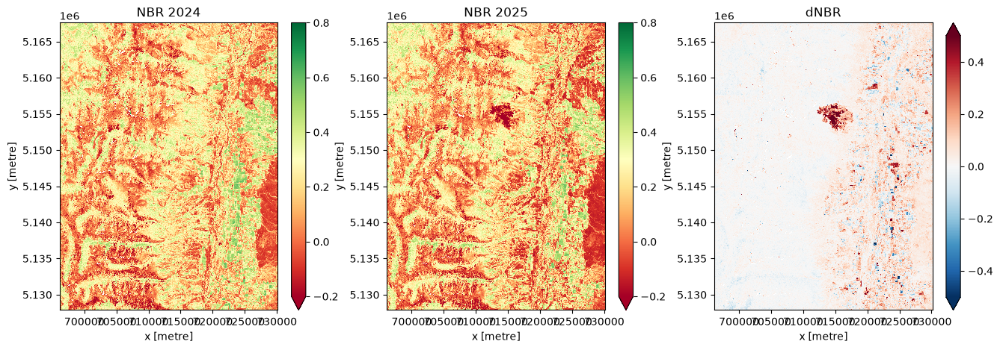

# Forest Disturbance Detection Utilizing Sentinel-2 Datasets.

> Detecting forest disturbance and burn scars with Sentinel-2 dNBR, starting with the 2024 St. Mary fire in the Bitterroot.

---

## Overview

I am curious about the state and change of the forests of North America. I want to use Montana's unique position of holding a large amount of public forests and frequent forest harvesting and wildfire incidents as an opportunity to identify, track, and predict forested landcover change over time. This project will build an end-to-end geospatial data science pipeline that addresses a few forest land-cover change problems:

1. **Forest Harvest Tracking** -- Where is forest harvest activity happening.
2. **Wildfire Risk Modeling** -- Where is fire most likely to ignite and spread, *before* it starts?
3. **Active Fire & Burn Perimeter Detection** -- Once a fire starts, can I detect it and define its perimeter from satellite imagery in near real-time?
Burn severity markers:
 https://un-spider.org/advisory-support/recommended-practices/recommended-practice-burn-severity/in-detail/normalized-burn-ratio

---
## Current State

Currently this project just includes a single notebook exploring the detection of a single fire around St. Mary Peak in the Bitterroot Mountains during the 2024 fire season. This is a launching off point to start re-tooling skills I have developed over my time as a geospatial developer.

I used Sentinel-2 L2A imagery from Earth Search to detect the 2024 St. Mary fire by comparing two summer windows (May 15 to July 31, 2024 vs. 2025). The windows cover the growing season and end before wildfire smoke becomes common. For each window I masked clouds and snow, computed the median NBR per pixel, and subtracted the two (dNBR). Areas where dNBR exceeds 0.2 and cover at least 1 acre were flagged as disturbance. The method also flags agricultural change in the valley, since crop rotation shows up the same way.

**Known Issues**
- Valley agriculture is flagged
- z-scores respond to crop rotation
- system is set up to detect across two summer windows and I would like this to eventually detect "real time"

**Next Steps** 
- Implement NLCD dataset to filter for Forest Only locations
  - Eventually create a forest classifier model
- Begin using other spectral indices to also detect timber harvesting
  - Both:
    - Clearcut
    - Thinning
- I would also like to track Snow reflectance/albedo and snowline over time
